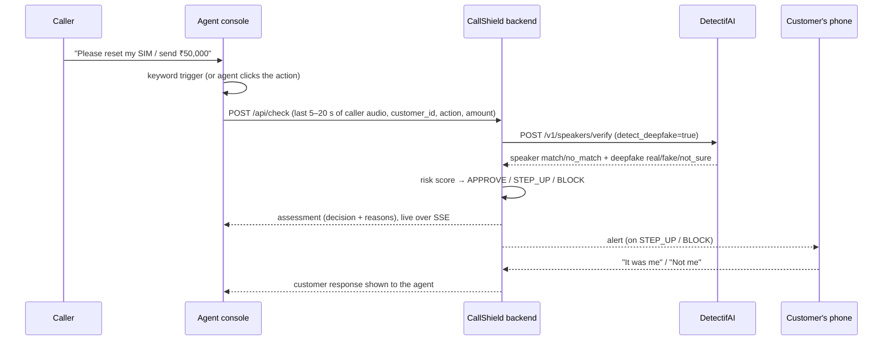

# CallShield

**A real-time fraud guard for bank and UPI support calls. Powered by DetectifAI.**

UNCLONE AI Hackathon · DetectifAI × B.M.S. College of Engineering · 16–17 Oct 2026 · **Track 01: Unclone Finance**

> A caller phones the bank's helpline, sounds exactly like the account holder and asks for a SIM/OTP reset or a ₹50,000 transfer.
> CallShield takes the last few seconds of that caller's voice and asks DetectifAI two questions: **is this voice real?** and **is it the
> enrolled customer?** It then **APPROVES, STEPS UP or BLOCKS** the action and alerts the real customer on a trusted channel.

---

## 1. Problem: one user, one moment

| | |
|---|---|
| **User** | The **support agent on a bank / UPI helpline**, who has to decide on the spot whether to carry out what the caller asks. |
| **Who gets hurt** | The **account holder**, whose voice has been cloned from voice notes, reels or an earlier "survey" call. |
| **The moment** | A caller who sounds like the customer gets past the usual security questions (data from leaks, social engineering) and asks for a **high-risk action**: SIM/OTP reset, fund transfer, limit change or a new beneficiary. |
| **Why today's checks fail** | Knowledge questions can be answered by anyone who has the customer's data. Voice-ID on its own has been beaten by an off-the-shelf clone (Vice/Lloyds Bank, Feb 2023). The agent's own ear can't tell a good clone from the real person. |

What CallShield changes: **the high-risk action does not go through until DetectifAI says the voice is real and belongs to the customer.**

## 2. How it works

```
   Caller (on the support line)
          │  audio
          ▼
 ┌─────────────────────────────┐   rolling buffer of the last few seconds
 │  Agent console (index.html) │   (16 kHz mono PCM, Web Audio API)
 │  - live call, mic capture   │
 │  - keyword trigger (Web     │   "transfer", "SIM", "OTP", "limit", "beneficiary" ...
 │    Speech API) or button    │
 └──────────────┬──────────────┘
                │ HIGH-RISK REQUEST DETECTED → WAV clip (5–20 s)
                ▼
 ┌─────────────────────────────┐        ┌────────────────────────────────────────┐
 │  CallShield backend         │  ───▶  │ DetectifAI  POST /v1/speakers/verify   │
 │  (FastAPI)  POST /api/check │        │   speaker verification                 │
 │                             │  ◀───  │   + detect_deepfake=true  (1 request)  │
 └──────────────┬──────────────┘        └────────────────────────────────────────┘
                │ deepfake verdict + speaker decision
                ▼
 ┌─────────────────────────────┐
 │  Risk engine (risk.py)      │  deterministic, explainable score 0–100
 └──────┬─────────┬─────────┬──┘
        ▼         ▼         ▼
     APPROVE   STEP UP    BLOCK  ──────▶ alert to the real customer's phone
     (action   (extra     (action        (phone.html, pushed live over SSE)
      goes      checks)    refused)       customer taps "It was me" / "Not me"
      ahead)
```



### Where each DetectifAI API sits, and what decision it drives

| DetectifAI API | Where in the flow | What it answers | Decision it drives |
|---|---|---|---|
| **Speaker Verification**: `POST /v1/speakers/enroll` | Once, at onboarding (`/enroll.html`): 15–60 s of the customer's voice | Creates the customer's voiceprint (`speaker_id` = customer id) | Without it there is nothing to verify against; the caller is treated as unverified (+20 risk) |
| **Speaker Verification**: `POST /v1/speakers/verify` | At the high-risk moment, on the last 5–20 s of caller audio | "Is this the enrolled customer?" (`match` / `no_match`, similarity vs threshold) | `no_match` adds +50 → STEP UP or BLOCK |
| **Deepfake Detection**: `detect_deepfake=true` on the same verify call | Same request, same clip | "Is this voice real or synthetic?" (`real` / `fake` / `not_sure`, score vs 0.62) | `fake` means **BLOCK, always**. `not_sure` means STEP UP at minimum |
| **Deepfake Detection**: `POST /v1/deepfake/detect` | Unknown or un-enrolled caller (no `customer_id`) | "Is this voice real?" | Deepfake-only check; identity unverified (+20) |
| **Feedback**: `POST /v1/operations/{id}/feedback` (free) | After the outcome is known | Was the verdict correct? | Closes the loop with DetectifAI (`/api/feedback`) |

**Why both signals are needed:** a good clone of the customer can still *match* on speaker verification, because it is built to sound like them.
Deepfake detection catches the clone. Speaker verification catches a real human impersonator, who won't be flagged as synthetic.
**If you take DetectifAI out, CallShield has no signal and no decision. The product is the decision made on DetectifAI's result.**

## 3. Risk engine (`backend/risk.py`): deterministic and explainable

| Signal | Points |
|---|---|
| Deepfake verdict `fake` | **+70** |
| Deepfake verdict `not_sure` | +30 |
| Deepfake verdict `real` | + round(score × 20) (0–20) |
| Deepfake result missing (DetectifAI error / unavailable) | +30, and **never APPROVE** (fails closed) |
| Speaker `no_match` | **+50** |
| Speaker `match` but similarity < threshold + 0.10 (weak match) | +10 |
| No speaker check (unknown caller / not enrolled) | +20 ("Caller not enrolled — identity unverified") |
| Action `sim_otp_reset` | +15 |
| Action `fund_transfer` | +10 (**+10 more** if amount ≥ ₹50,000) |
| Action `limit_change` | +10 |
| Action `beneficiary_add` | +10 |

Score is clamped to 0–100.

| Decision | Rule | What happens |
|---|---|---|
| **BLOCK** | verdict = `fake` **or** score ≥ 70 | Action refused; customer alerted ("…blocked… your money is safe") |
| **STEP UP** | score ≥ 35 **or** verdict = `not_sure` **or** no deepfake verdict | Agent must complete extra verification; customer asked to confirm in the app |
| **APPROVE** | otherwise | Action proceeds; no alert |

Risk level: high (≥ 70) / medium (≥ 35) / low. Every assessment lists its **reasons** in plain language, e.g.
`Synthetic voice detected (score 0.81)`, `Voice does not match enrolled customer (0.21 < 0.53)`, `High-risk action: Fund transfer ₹50,000`.

Worked examples (the three demo scenes):

| Scene | Deepfake | Speaker | Action | Score | Decision |
|---|---|---|---|---|---|
| Genuine customer | real, ~0.1 → +2 | match, strong → 0 | Transfer ₹50,000 → +20 | ~22 | **APPROVE** |
| Voice clone of the customer | **fake** → +70 | often still *match* → 0–10 | SIM/OTP reset → +15 | 85–100 | **BLOCK** |
| Teammate impersonating | real, ~0.1 → +2 | **no_match** → +50 | Add beneficiary → +10 | ~62 | **STEP UP** (a ₹50,000 transfer would score ~72 → BLOCK) |

## 4. Setup and run (Windows, desktop Chrome)

Requirements: Python 3.15 with a venv at `.venv` (fastapi, uvicorn, httpx, python-multipart, python-dotenv). No npm and no build step.

```powershell
# 1. one-time: create the venv and install deps (skip if .venv already exists)
py -m venv .venv
.venv\Scripts\python -m pip install fastapi uvicorn httpx python-multipart python-dotenv

# 2. API key: create .env in the project root (never commit it; it is in .gitignore)
#    DETECTIF_API_KEY=dtf_live_xxxxxxxxxxxxxxxx

# 3. run
.\run.ps1
#    or directly:
.venv\Scripts\python -m uvicorn backend.app:app --port 8000
#    add  --host 0.0.0.0  so a second device on the same Wi-Fi can open phone.html
```

Open **http://localhost:8000/** in Chrome. The mic needs `localhost` or HTTPS.

### Mock mode (no credits spent)

```powershell
$env:CALLSHIELD_MODE = "mock"; .venv\Scripts\python -m uvicorn backend.app:app --port 8000
```

Mock mode is on whenever `CALLSHIELD_MODE=mock` **or** no API key is set. Every mock result carries a **`MOCK` badge**, a global banner is shown
and the status pill reads `MOCK MODE` (amber). In live mode the pill reads `LIVE · DetectifAI` (green), next to the credits remaining.
Mock scenarios (`genuine`, `deepfake`, `imposter`, `uncertain`) return realistic shapes with `mock_` IDs. **Mock results are never presented as live** (hackathon rule 5.4).

### Public link for judges (no login)

Judges must be able to open the prototype without a login. Expose the local server over HTTPS (HTTPS also lets the mic work on other devices):

```powershell
cloudflared tunnel --url http://localhost:8000     # prints a https://<random>.trycloudflare.com URL
```

Live checks spend real credits. The backend refuses a check when the balance is below 100 (`insufficient_credits`).

## 5. Pages

| Page | Who uses it | What it does |
|---|---|---|
| `/` (index.html) | **Support agent**: the live call console | Mic capture, rolling buffer, keyword trigger, action + amount, decision card with reasons, scores, latency, credits, history, customer's reply |
| `/enroll.html` | **Customer** (onboarding) | Records or uploads 15–60 s of voice (≥ 10 s speech) and enrols it with DetectifAI as the customer's voiceprint |
| `/phone.html` | **Customer's phone**: the trusted channel | Receives STEP UP / BLOCK alerts live over SSE; buttons **"It was me"** / **"Not me"** go straight back to the agent console |
| `/attack.html` | **Team member, red-teaming** (presenter's laptop only) | Attack Lab: clone your own voice and fire it at CallShield (see below) |
| `/caller.html` | **The caller**, on a phone | Calls the bank helpline: the agent console rings, and the call audio goes through CallShield (see below) |

### Phone calls into the console (WebRTC)

A phone can call the agent console like a real helpline call. Open `/caller.html` in Chrome on the phone, pick who you are
calling as and tap **Call bank**; the console shows **Incoming call** and the agent clicks **Answer**. Both sides hear each other.

- Audio flows **peer to peer** between the two browsers; the backend only relays call setup over `WS /api/call/ws`
  (`backend/calls.py`). Both devices on the same network (e.g. a phone hotspot) is the reliable setup.
- The console feeds the **caller's incoming audio** into the same 30 s rolling buffer, keyword trigger and `/api/check` as the
  laptop mic. The agent's own voice is never checked.
- **Live transcript runs on the laptop**, on the call audio (Chrome speech recognition fed a Web Audio copy of the caller's
  track). Nothing runs on the phone; phone-side transcription is an optional, off-by-default box. If this Chrome can't take an
  audio track, the console falls back to local Whisper on the GPU service (`/api/transcribe` → `cloner/asr.py`), then to the
  action buttons.
- The phone can **play a consented sample into the call** (its mic is muted meanwhile), so a clone reaches the agent over a real call.
- The phone needs HTTPS for its mic: use the public link, or `adb reverse tcp:8000 tcp:8000` and open `http://localhost:8000/caller.html`.
- Optional access code: set `CALLSHIELD_CALL_CODE` and open both pages with `?code=…` (leave it unset on the judges' link).

### Attack Lab (local red-team)

*Fraudsters need ~20 s of your voice from a reel or voice note.* The Attack Lab lets a team member clone **their own** voice (consent checkbox
required, rule 5.3) and send the clone through the real `/api/check`, next to a check of their real voice: real → APPROVE, clone → BLOCK.

1. Start the local voice-cloning service in a second terminal: `.\run_cloner.ps1` (listens on `http://127.0.0.1:8100`; override with
   `CALLSHIELD_CLONER_URL`). Engines: a local GPU model and, if configured there, ElevenLabs.
2. Open **http://localhost:8000/attack.html** on the laptop (the "Attack Lab" nav link appears only there).
3. **Reference voice**: record 15–40 s from the mic (or upload your own voice note) and tick *"This is my own voice and I consent…"*.
4. **Fraudster script**: pick a quick script (₹50,000 transfer, SIM/OTP reset, add beneficiary, limit increase) or write one (≤ 400 chars),
   choose the engine, **Generate clone** → player, generation time, engine/model, download link.
5. **Attack CallShield**: pick the customer the clone claims to be and the action → the clone goes to `/api/check` (`trigger=upload`,
   transcript = the script). **Compare with your real voice** checks the reference recording as the same customer. Each live check costs ~100 credits
   (confirmed once per session); results also appear in the Agent Console's audit log. **Play into live call** plays the clone at full volume so a
   running console call can pick it up from the speakers.

**Laptop-only by design.** `/api/attack/*` and `/attack.html` answer only when `CALLSHIELD_ATTACK_LAB` ≠ `0`, the TCP client is `127.0.0.1`/`::1`,
the `Host` (and any `Origin`) is a loopback name, and the request has **no proxy/tunnel headers** (`cf-connecting-ip`, `cf-ray`, `x-forwarded-for`,
`x-forwarded-host`, `x-real-ip`, `forwarded`, …). cloudflared connects from localhost but adds those headers, so judges on the public link get
`403 attack_lab_disabled` and never see the nav link. Clones are proxied straight back to the browser and are not stored by CallShield.
Set `CALLSHIELD_ATTACK_LAB=0` to switch the lab off completely.

## 6. Backend API (same origin)

Every response with a DetectifAI result carries `"mode": "live" | "mock"`.

| Method | Path | Purpose |
|---|---|---|
| GET | `/api/status` | Mode, credits, DetectifAI health, `cost_per_check: 100` |
| GET | `/api/customers` | Enrolled customers |
| POST | `/api/enroll` | multipart `file`, `customer_id`, `display_name`, `phone_last4?` → DetectifAI enroll |
| POST | `/api/check` | multipart `file` (WAV 5–20 s), `customer_id` (empty = unknown caller), `action`, `amount?`, `call_id`, `trigger` (`manual`/`keyword`/`upload`), `transcript?` → **Assessment** (deepfake, speaker, risk, alert, credits, latency) |
| GET | `/api/assessments?limit=50` | History, newest first |
| GET | `/api/events` | Server-Sent Events: `assessment`, `alert`, `customer_response` |
| POST | `/api/alerts/{check_id}/respond` | `{"response": "me" \| "not_me"}` from the customer's phone |
| POST | `/api/feedback` | `{operation_id, correct}` → DetectifAI feedback (free) |
| GET | `/api/attack/status` | Attack Lab (laptop-only): `{enabled, reason, cloner}` (`?probe=0` skips the cloner health probe) |
| POST | `/api/attack/clone` | Attack Lab: multipart `reference`, `text` (≤ 400), `engine` (`local`/`elevenlabs`), `language?`, `consent=true` → `audio/wav` + `X-Engine`, `X-Model`, `X-Gen-Ms` |
| POST | `/api/attack/warmup` | Attack Lab: load the local cloning model ahead of the demo |

DetectifAI upstream: `https://platform.detectif.ai/v1`, Bearer auth, multipart with an `Idempotency-Key` per request. On 429/503 it retries once with the same
key after `Retry-After`, and treats 402 as out of credits. The API key is read from `.env` and is never logged or returned.

## 7. Credit-budget design: spend only at the high-risk moment

- Budget: **2,000 credits, 50 per DetectifAI operation.** One check (verify + deepfake in one request) = 2 operations = **~100 credits**, so we get about **20 live checks in total**.
- CallShield **does not** stream every second of every call to the API. It keeps a local rolling buffer and spends credits **only when the caller asks
  for a high-risk action.** Small talk, balance enquiries and address questions cost nothing.
- All development and testing runs in **mock mode**. Free calls only: `/v1/health`, `/v1/credits`, `/v1/speakers`.
- The backend checks `/v1/credits` (cached 30 s) before spending and refuses below 100.
- This is also the business model: **cost per protected transaction, not per call minute** (see `pitch/deck.md`, Scale).

| Planned spend | Credits |
|---|---|
| Development | 0 (mock) |
| Enrol the "customer" team member (+1 extra sample on Day 2) | 50–100 |
| Day 1: one live rehearsal of the clone scene | 100 |
| Day 1 judging: 3 scenes (+1 retry reserve) | 300 (+100) |
| Day 2: 8 kHz robustness tests, rehearsal | ~300–400 |
| Day 2 finals: 3 scenes (+1 retry reserve) | 300 (+100) |
| **Total** | **~1,450–1,550 of 2,000** (the rest is a buffer for judges trying the link) |

## 8. Consent and ethics

- **Only consented voices.** Every voice in the demo belongs to a team member who agreed to it. The only voice clone is of a **consenting team member**, made
  by that member for this demo (rule 5.3). No public figures, staff or other participants.
- **Live means live** (rule 5.4). Results shown as live come from real DetectifAI calls made on stage. Mock results are always visibly labelled `MOCK`.
- **Voiceprints:** enrolment needs the customer's explicit opt-in. The voiceprint is held by DetectifAI under the customer id. CallShield's own store
  (`data/store.json`) holds customer metadata and assessment results. In a bank deployment this falls under India's DPDP Act 2023 (consent, purpose limitation,
  deletion on request).
- **Explainable, not a black box.** Every decision lists its reasons. STEP UP (not BLOCK) is the default for uncertain signals, so a genuine customer
  is never locked out by one borderline score. A BLOCK stops *one action*; it does not close the account or end the call.
- The Chrome Web Speech API (keyword trigger) sends audio to Google for transcription. In production this would be replaced with an on-premise ASR or the
  bank's own transcription. The agent can always trigger a check by hand.

## 9. Tools used (disclosure, rule 5.2)

- **DetectifAI Speaker Verification API** (enroll, verify) and **DetectifAI Deepfake Detection API** (embedded in verify; standalone detect for unknown callers); feedback endpoint
- **Python 3.15 / FastAPI / uvicorn / httpx / python-dotenv** (backend)
- **Vanilla HTML/CSS/JS + Web Audio API** (mic capture, 16 kHz WAV encoding), **Server-Sent Events** (live alerts)
- **Chrome Web Speech API** (keyword trigger)
- Voice-clone generation for the consenting team member: **[fill in the tool used, e.g. ElevenLabs / open-source TTS]**
- cloudflared (public HTTPS link for judges), if used

## 10. Team

| Name | Role | College / programme |
|---|---|---|
| [Member 1] | [e.g. backend + DetectifAI integration] | [ ] |
| [Member 2] | [e.g. frontend + audio] | [ ] |
| [Member 3] | [e.g. product, pitch, demo; enrolled "customer" voice] | [ ] |

More: [`DEMO.md`](DEMO.md) (3-minute judge demo), [`pitch/deck.md`](pitch/deck.md) (5-slide deck + Day 2 plan), [`CONTRACT.md`](CONTRACT.md) (build spec).
